# ERD — RF Personal Tech Dashboard

Acuan: `docs/blueprint-v1.0.md` §8 dan `docs/technical-decisions.md` (TD-07, TD-09, TD-06, TD-03).
Sumber kebenaran struktural: `prisma/schema.prisma`.

- 18 model, 4 enum (`CollectionType`, `CategoryKind`, `UsageStatus`, `Locale`).
- Semua PK `String @id` tanpa default database — nilai cuid2 24 karakter dibuat di application layer (TD-07).
- Nama tabel & enum di PostgreSQL memakai `@@map` / `@map` snake_case.

## Diagram

```mermaid
erDiagram
    Admin ||--o{ Session : "adminId"

    MediaFolder ||--o{ Media : "folderId"
    Media o|--o{ CollectionItem : "logoMediaId"
    Media o|--o{ Project : "coverMediaId"
    Media o|--o{ SocialMedia : "logoMediaId"
    Media o|--o{ LearningField : "logoMediaId"
    Media o|--o{ Profile : "avatarMediaId"
    Media ||--o| Resume : "mediaId"

    Category ||--o{ Subcategory : "categoryId"
    Category ||--o{ CollectionItem : "categoryId"
    Category ||--o{ Project : "categoryId"
    Subcategory o|--o{ CollectionItem : "subcategoryId"
    CollectionItem ||--o{ ItemLink : "itemId"

    Admin {
        string id PK "cuid2"
        string username UK
        string passwordHash "Argon2id"
        datetime passwordUpdatedAt
        datetime lastLoginAt
        datetime createdAt
    }

    Session {
        string id PK "cuid2"
        string tokenHash UK "SHA-256(token)"
        string adminId FK
        datetime createdAt
        datetime expiresAt "sliding 30 hari"
        datetime absoluteExpiresAt "cap 90 hari"
        datetime lastUsedAt
        datetime revokedAt
        string ipHash
        string userAgentHash
    }

    Profile {
        string id PK "singleton, cuid2"
        string displayName
        string tagline
        string bio "Text"
        string interests "Text"
        string goals "Text"
        string avatarMediaId FK
        string locationLabel
        Locale sourceLocale
        datetime updatedAt
    }

    MediaFolder {
        string id PK "cuid2"
        string name
        string nameSort
        datetime createdAt
        datetime updatedAt
    }

    Media {
        string id PK "cuid2"
        string publicId UK "Cloudinary public_id"
        string secureUrl
        string format
        string resourceType
        int bytes
        int width
        int height
        string alt "diterjemahkan (TD-15)"
        string originalName
        string originalNameSort
        Locale sourceLocale
        string folderId FK
        datetime createdAt
    }

    Category {
        string id PK "cuid2"
        CategoryKind kind
        string name
        string nameSort
        string description
        int sortOrder
        Locale sourceLocale
        datetime createdAt
        datetime updatedAt
    }

    Subcategory {
        string id PK "cuid2"
        string categoryId FK
        string name
        string nameSort
        int sortOrder
        Locale sourceLocale
        datetime createdAt
        datetime updatedAt
    }

    CollectionItem {
        string id PK "cuid2"
        CollectionType type
        string categoryId FK
        string subcategoryId FK
        string name
        string nameSort
        string description "Text"
        string logoMediaId FK
        UsageStatus usageStatus
        Locale sourceLocale
        datetime createdAt
        datetime updatedAt
    }

    ItemLink {
        string id PK "cuid2"
        string itemId FK
        string label
        string url
        int sortOrder
    }

    Project {
        string id PK "cuid2"
        string categoryId FK "kind PROJECT"
        string title
        string titleSort
        string description "Text"
        string coverMediaId FK
        string primaryUrl
        Locale sourceLocale
        datetime createdAt
        datetime updatedAt
    }

    SocialMedia {
        string id PK "cuid2"
        string platform
        string platformSort
        string username
        string profileUrl UK
        string logoMediaId FK
        int sortOrder
        datetime createdAt
        datetime updatedAt
    }

    LearningField {
        string id PK "cuid2"
        string name
        string nameSort
        string description
        string logoMediaId FK
        int sortOrder
        Locale sourceLocale
        datetime createdAt
        datetime updatedAt
    }

    Device {
        string id PK "cuid2"
        string name
        string nameSort
        string processor
        string ram
        string gpu
        string storage
        string operatingSystem
        string notes
        int sortOrder
        datetime createdAt
        datetime updatedAt
    }

    TimelineEntry {
        string id PK "cuid2"
        datetime date "Date (date-only)"
        string title
        string category
        string description "Text"
        Locale sourceLocale
        datetime createdAt
    }

    Resume {
        string id PK "cuid2"
        string mediaId UK "FK; satu CV aktif"
        datetime updatedAt
    }

    VisitorEvent {
        string id PK "cuid2"
        string visitId UK "UUID dari klien"
        boolean isOwner
        string entryPath
        string referrerHost
        datetime createdAt
    }

    SiteConfiguration {
        string id PK "singleton: site_config"
        float ownerLat
        float ownerLng
        string ownerLocationLabel
        datetime ownerLocationUpdatedAt
        datetime ownerLastSeenAt
        Locale defaultLocale
        datetime updatedAt
    }

    ContactConfiguration {
        string id PK "singleton: contact_config"
        string recipientEmail
        string fromName
        string subjectPrefix
        boolean captchaEnabled
        datetime updatedAt
    }
```

Catatan kardinalitas:

| Relasi | Kardinalitas | onDelete |
|---|---|---|
| Admin → Session | 1 : 0..N | `Cascade` (hapus admin mencabut sesi) |
| MediaFolder → Media | 1 : 0..N | `Restrict` (folder berisi media tidak dapat dihapus) |
| Media → CollectionItem (logo) | 0..1 : 0..N | `Restrict` (TD-09) |
| Media → Project (cover) | 0..1 : 0..N | `Restrict` (TD-09) |
| Media → SocialMedia (logo) | 0..1 : 0..N | `Restrict` (TD-09) |
| Media → LearningField (logo) | 0..1 : 0..N | `Restrict` (TD-09) |
| Media → Profile (avatar) | 0..1 : 0..N | `Restrict` (TD-09) |
| Media → Resume | 1 : 0..1 | `Restrict` (TD-09) |
| Category → Subcategory | 1 : 0..N | `Cascade` (subkategori milik kategori) |
| Category → CollectionItem | 1 : 0..N | `Restrict` (item tidak boleh hilang diam-diam) |
| Category → Project | 1 : 0..N | `Restrict` |
| Subcategory → CollectionItem | 0..1 : 0..N | `SetNull` (subkategori opsional) |
| CollectionItem → ItemLink | 1 : 0..N | `Cascade` (tautan milik item) |

## Constraint & Index

| Constraint / Index | Tabel | Alasan | TD terkait |
|---|---|---|---|
| `String @id` tanpa default pada 18 model | semua | Nilai cuid2 dibuat di application layer; tidak ada lookup ID numerik | TD-07 |
| `admins.username @unique` | admins | Satu akun Admin, login berbasis username | TD-06, blueprint §9.1 |
| `sessions.tokenHash @unique` | sessions | Cookie `rf_sess` dipetakan ke SHA-256(token); rotasi ID saat login/perpanjangan/ganti kredensial | TD-06 |
| `sessions @@index([adminId])` | sessions | Revoke semua sesi saat ganti password/logout | TD-06 |
| `sessions @@index([expiresAt])` | sessions | Pembersihan sesi kedaluwarsa | TD-06 |
| `categories @@unique([kind, name])` | categories | Nama kategori unik dalam satu jenis (AI/TOOL/WEBSITE/PROJECT) | blueprint §5.1–5.5 |
| `categories @@index([kind, nameSort])`, `@@index([nameSort])` | categories | Daftar kategori per jenis, urut A–Z | TD-07 |
| `subcategories @@unique([categoryId, name])` | subcategories | Nama subkategori unik per kategori induk | blueprint §8.3 |
| `subcategories @@index([categoryId, nameSort])`, `@@index([nameSort])` | subcategories | Urut A–Z per kategori | TD-07 |
| `collection_items @@index([type, categoryId])` | collection_items | Query koleksi per jenis + kategori | TD-08 |
| `collection_items @@index([type, usageStatus])` | collection_items | Filter status penggunaan | blueprint §8.2 |
| `collection_items @@index([nameSort])` | collection_items | Previous/Next dan daftar A–Z | TD-07 |
| `collection_items @@index([subcategoryId])`, `@@index([logoMediaId])` | collection_items | Cek referensi saat hapus media/subkategori (409) | TD-09 |
| `item_links @@index([itemId, sortOrder])` | item_links | Tautan eksternal berurutan | blueprint §8.2 |
| `media.publicId @unique` | media | Identitas aset Cloudinary, dasar penelusuran manual | TD-09 |
| `media @@index([folderId, createdAt])` | media | Media Library per folder, urut terbaru (24 + 48) | TD-08, TD-09 |
| `media.originalNameSort` + index | media | Pencarian/urut nama file di Media Library | TD-07 |
| `projects @@index([categoryId, titleSort])`, `@@index([titleSort])` | projects | Daftar proyek per kategori, urut A–Z | TD-07, TD-08 |
| `social_media.profileUrl @unique` | social_media | Satu entri per profil; mencegah duplikat | blueprint §5.4 |
| `social_media @@index([platformSort])` | social_media | Urut platform | TD-07 |
| `learning_fields @@index([nameSort])` | learning_fields | Urut bidang A–Z | TD-07 |
| `devices @@index([nameSort])` | devices | Urut perangkat A–Z | TD-07 |
| `media_folders @@index([nameSort])` | media_folders | Urut folder A–Z | TD-07 |
| `timeline_entries @@index([date])` | timeline_entries | Timeline kronologis + cursor pagination 20 + 20 | TD-08 |
| `resumes.mediaId @unique` | resumes | Tepat satu CV aktif | blueprint §5.12 |
| `visitor_events.visitId @unique` | visitor_events | Idempotensi satu event per full page load | TD-03 |
| `visitor_events @@index([createdAt])`, `@@index([isOwner])` | visitor_events | Statistik kunjungan per rentang waktu; pemisahan owner | TD-03 |
| FK media `onDelete: Restrict` | collection_items, projects, social_media, learning_fields, profiles, resumes | Media terreferensi tidak dapat dihapus → 409 | TD-09 |
| FK `Category → Subcategory` `Cascade` | subcategories | Subkategori tidak bermakna tanpa induk | blueprint §8.3 |
| FK `Subcategory → CollectionItem` `SetNull` | collection_items | Subkategori opsional, item tidak boleh terhapus | blueprint §8.2 |

## Seed Default

| Entitas | Jumlah | Nilai |
|---|---|---|
| `Category` kind AI | 6 | Chatbot, Image Generation, Video Generation, Voice AI, Coding AI, Automation (sortOrder 1..6) |
| `Category` kind TOOL | 5 | Development Tools, Design Tools, Productivity Tools, Automation Tools, Media & Content Tools |
| `Category` kind PROJECT | 5 | Website, Mobile App, AI, Automation, Game |
| `Category` kind WEBSITE | 0 | Dikelola Admin sepenuhnya (blueprint §5.3) |
| `Subcategory` | 0 | Dibuat Admin sesuai kebutuhan |
| `LearningField` | 5 | Programming, AI, Cybersecurity, Design, Networking |
| `MediaFolder` | 5 | AI, Tools, Websites, Projects, Profile |
| `SiteConfiguration` | 1 | id `site_config`, `defaultLocale = ID`, lokasi/presence kosong |
| `ContactConfiguration` | 1 | id `contact_config`, `recipientEmail` dari `ADMIN_EMAIL` (fallback string kosong), `subjectPrefix = "[RF Contact]"`, `captchaEnabled = true` |
| `Admin` | 0 atau 1 | Dibuat hanya bila `ADMIN_USERNAME` dan `ADMIN_PASSWORD` diset; hash Argon2id m=19456, t=2, p=1 |
| `CollectionItem`, `Project`, `SocialMedia`, `Device`, `TimelineEntry`, `Media`, `Resume`, `VisitorEvent` | 0 | Tanpa data sampel |

Seed bersifat idempotent: `upsert` dengan `update: {}` dan id stabil 24 karakter, sehingga run ulang tidak menimpa perubahan Admin.

## Keputusan Desain

1. **Singleton tanpa default id.** `Profile`, `SiteConfiguration`, `ContactConfiguration`, `Resume` tidak memakai id default; satu baris dijaga oleh application layer (seed `site_config` / `contact_config`). Tidak ada constraint DB yang memaksa jumlah baris = 1 karena jumlah baris bukan urusan skema.
2. **`sourceLocale` per record, bukan per field.** Mengikuti TD-15: satu bahasa sumber per item; terjemahan dilakukan saat runtime dan tidak disimpan. `Media.sourceLocale` mengikuti bahasa `alt`.
3. **`nameSort` sebagai kolom pendamping.** `ORDER BY lower(name)` tidak dapat memakai index biasa secara konsisten antar-collation; nilai lowercase tanpa diakritik disimpan eksplisit dan di-index, `id` menjadi tiebreaker (TD-07). Diperlukan pada 9 field yang dapat diurutkan A–Z.
4. **`Restrict` pada semua referensi media.** Menghapus media yang masih dipakai harus gagal (409) dan tidak pernah memicu hapus aset Cloudinary (TD-09). `Cascade` hanya untuk relasi kepemilikan murni: `Category → Subcategory`, `CollectionItem → ItemLink`.
5. **`Subcategory → CollectionItem` memakai `SetNull`.** `subcategoryId` opsional; menghapus subkategori tidak boleh menghapus item koleksi.
6. **cuid2 di application layer.** Tidak ada `@default(cuid())`, `uuid()`, atau `autoincrement()`. Baris seed memakai id 24 karakter stabil berbentuk cuid2 agar `upsert` deterministik, sementara baris baru memakai `createId()`.
7. **Index komposit mengikuti pola query nyata.** `[type, categoryId]` dan `[type, usageStatus]` untuk koleksi; `[folderId, createdAt]` untuk Media Library; `[categoryId, titleSort]` untuk proyek — bukan index per kolom yang tidak pernah dipakai bersama.
8. **`profiles` plural walau singleton.** `@@map` tetap snake_case plural sesuai konvensi tabel; jumlah baris dibatasi di layer aplikasi, bukan lewat nama tabel.
